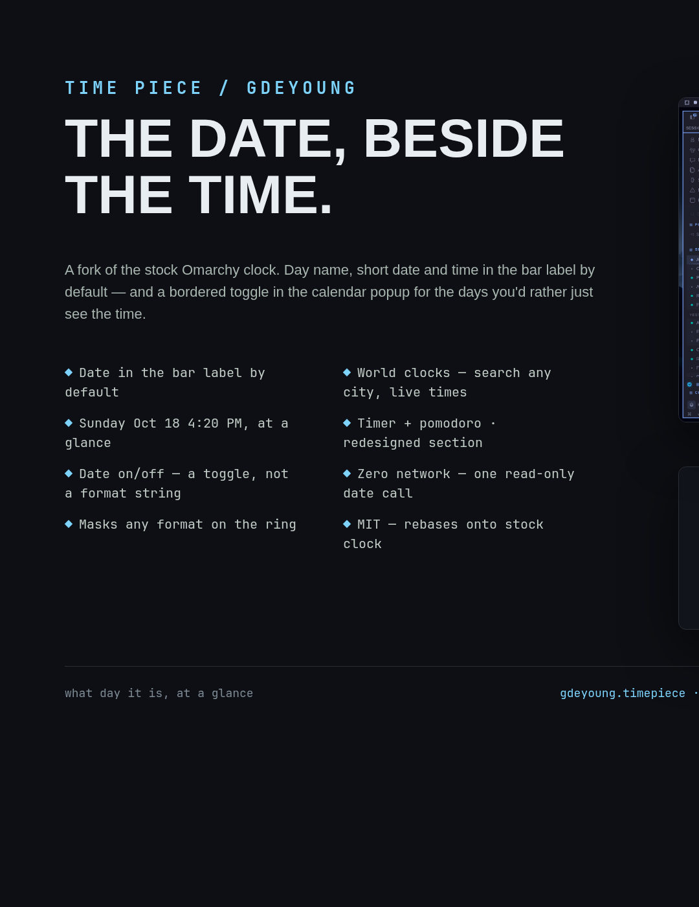

# Time Piece (gdeyoung.timepiece)



Fork of the stock Omarchy clock — the bar label shows the date by default:
**`Sunday Oct 18 4:20 PM`** instead of `Sunday 4:20 PM`, with a date on/off
toggle, an optional world-clock row, and a start/stop countdown timer in the
calendar popup.

## What it changes

Four things, everything else is stock:

1. **The default bar format is `dddd MMM d h:mm AP`** — day name, short
   date, 12-hour time. The format is still a plain setting (right-click the
   clock to walk the preset ring, same as stock).
2. **A `showDate` setting with a toggle in the calendar popup** — a bordered
   `DATE IN BAR · ON/OFF` pill at the bottom of the calendar. Clicking it
   writes back to `~/.config/omarchy/shell.json` and the bar label changes
   live.
3. **An optional world-clock row** — times in up to five other zones, right
   under the date hero, chosen in the settings view (below) or by hand:
   `ET:America/New_York,PT:America/Los_Angeles` and the popup carries
   `ET 5:20 PM  PT 2:20 PM`. Unset (default) hides the row. The QML engine
   has no timezone support, so each configured zone costs one read-only
   `TZ=<zone> date +%–%I:%M %p` call per minute, and the output is
   validated before it is shown.
4. **A countdown timer in the popup** — `−5M / +5M` steppers (1–600 min),
   `START / PAUSE / RESUME / RESET`. While it runs, the bar label carries
   the remaining time (`Sunday Oct 18 4:22 PM · 12:34`); when it fires, the
   label pings `· done` for two minutes and the popup shows `00:00` until
   reset. Timer state persists in the widget entry, so a run survives a
   shell restart.
5. **A pomodoro mode** — `START CYCLE` runs the classic pomodoro unattended:
   focus blocks alternate with breaks, every 4th break is a long one
   (15 min), and each phase flip fires a desktop notification
   (`omarchy-notification-send`). The bar shows phase + remaining time
   (`· F 17:32`, `· B 3:10`, `· L 14:59`). Focus and break lengths are
   steppers in the settings view. The manual timer and pomodoro are mutually
   exclusive — starting one stops the other.
6. **A redesigned timer section** (v0.5, spec in `design/timer-ux-spec.md`)
   — the readout *is* the section: a 24px `mm:ss` hero flanked by `−5M/+5M`
   steppers in fixed slots, `TIMER | POMODORO` mode tabs while idle
   (hidden while anything runs — mutual exclusion made visible), a thin
   remaining-time phase bar, a 4-segment rail for the set (accent = focus
   blocks done, half-alpha = in progress), and phase coloring always
   co-coded with the phase word (WCAG 1.4.1): focus = theme accent,
   break = green, long break = violet, done = urgent. Digits stay
   foreground in every state.
7. **World-clock label hues** — each configured zone gets a stable
   categorical color on its label (cyan, amber, rose, blue, orange); the
   time itself stays foreground. Greens/violets are deliberately excluded
   so zones never read as pomodoro phases.

`showDate: false` masks the date out of *whatever* format the label is in —
`dddd MMM d h:mm AP` becomes `dddd h:mm AP`, `yyyy-MM-dd HH:mm` becomes
`HH:mm` — while keeping the day name and the time. A format that is nothing
but date tokens (like the alternate `d MMMM 'W'ww yyyy`) is left unchanged
rather than rendering an empty clock.

### CLI

```sh
omarchy bar set gdeyoung.timepiece showDate false    # date off
omarchy bar set gdeyoung.timepiece showDate true     # date back on
omarchy bar set gdeyoung.timepiece format "dddd MMM d h:mm AP"
omarchy bar set gdeyoung.timepiece worldClocks "ET:America/New_York,PT:America/Los_Angeles"
```

Values written without `--json` land as strings; the plugin reads both
`false` and `"false"` as false, and numbers through `Number()`.

## Why a fork

The stock clock's default format carries no date, its format presets have
no day-name-plus-date entry, and there is no toggle, world clock, or timer.
Everything else is upstream code, so rebasing onto stock clock updates
stays small (Model.js, BarWidget.qml and Panel.qml are the only touched
files).

A small **gear at the popup's top-right** opens the settings view: world
clocks with live times (× to remove), a **type-to-search city picker** over
the full tz database (518 zones, verified against this machine's tzdata;
ET/PT/UTC aliases work), the date-in-bar toggle, and the timer default.
The popup itself stays a read-out.

## Settings

| Key          | Default                 | Meaning                                   |
|--------------|-------------------------|-------------------------------------------|
| `format`     | `dddd MMM d h:mm AP`    | Bar label format (stock ring + right-click cycling still work) |
| `formatAlt`  | `d MMMM 'W'ww yyyy`     | Alternate format (stock)                  |
| `showDate`   | `true`                  | Date in the bar label — the popup toggle  |
| `worldClocks`| *(empty)*               | `LABEL:Zone,...` row in the popup — pick region → city via the ZONES pill  |
| `timerMinutes` | `10`                  | Idle timer preset (1–600)                 |
| `pomodoroFocusMin`, `pomodoroBreakMin` | `25`, `5` | Pomodoro cycle lengths (steppers in settings) |
| `pomodoroMode`, `pomodoroEndsAt`, `pomodoroCyclesDone` | *(transient)* | Live pomodoro phase state |
| `timerRunning`, `timerEndsAt`, `timerRemainingMs`, `timerDoneAt` | *(transient)* | Live timer state — written by the popup controls, read by the bar |
| `verticalFormat`, `verticalFormatAlt`, `weekStartDay`, `birthYear`, `lifeExpectancy` | stock | Untouched stock settings |

## What the plugin runs

Two things, by design: `date` (coreutils, read-only) — one call per
configured world-clock zone per minute, as `TZ=<zone> date +%-I:%M %p`, with
the output shape-validated before display; and `omarchy-notification-send`
once per pomodoro phase flip (Omarchy's own notifier helper). No network,
no package manager, no writes anywhere outside Omarchy's own settings API
(`shell.setBarWidget` / `updateEntryInline`). The unit tests run
`node --test test/`.

## Install

```sh
omarchy plugin add https://github.com/gdeyoung/omarchy-timepiece.git --enable
omarchy bar put gdeyoung.timepiece --before omarchy.clock   # or wherever you want it
```

Then remove the stock clock from the bar (`omarchy bar move omarchy.clock`
out, or edit `~/.config/omarchy/shell.json`). Manual install:
`git clone <this repo> ~/.config/omarchy/plugins/gdeyoung.timepiece`.

**Remove:** `omarchy plugin remove gdeyoung.timepiece --yes` (then re-enable the
stock clock with `omarchy plugin enable omarchy.clock` and put it back on
the bar). All settings live in the `gdeyoung.timepiece` entry of
`~/.config/omarchy/shell.json` — nothing else is written outside Omarchy's
own config.

## Provenance

Forked from the first-party `omarchy.clock` shipped in **omarchy 4.0.5-1**
(`/usr/share/omarchy/shell/plugins/panels/clock`), 2026-10-18. Upstream
code (c) Omarchy, MIT — see LICENSE.

## Tests

```sh
node --test test/
```
